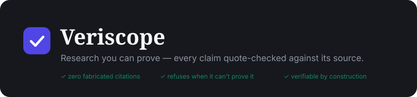

<p align="center">
  
</p>

<p align="center">
  <em>A research assistant that is <strong>verifiable by construction</strong> — every sentence it shows you is quote-checked against a real source, or it isn't shown at all.</em>
</p>

<p align="center">
  <a href="../../actions/workflows/ci.yml"></a>
  
  
  
  
  
  
</p>

> Replace `OWNER/REPO` in the CI badge URL with your GitHub path once pushed.

---

## Table of contents

- [TL;DR](#tldr)
- [The problem](#the-problem)
- [Core guarantees](#core-guarantees)
- [Demo](#demo)
- [Features](#features)
- [Architecture &amp; key decisions](#architecture--key-decisions)
- [Tech stack](#tech-stack)
- [Quick start (local)](#quick-start-local)
- [Run with Docker](#run-with-docker)
- [API](#api)
- [Testing, CI &amp; eval gate](#testing-ci--eval-gate)
- [Observability](#observability)
- [Scaling &amp; configuration](#scaling--configuration)
- [Project structure](#project-structure)
- [Roadmap](#roadmap)
- [Contributing](#contributing)
- [License](#license)

---

## TL;DR

Most AI research tools fabricate — plausible summaries with citations that are subtly wrong, sources that don't exist, numbers no paper reported. So you re-verify everything by hand and the time saving evaporates.

**Veriscope flips the default: nothing reaches you unless it survives a verification gate.** A multi-agent pipeline searches arXiv, Semantic Scholar, GitHub and engineering blogs, then drafts a report where **every claim must (1) cite a real chunk, (2) carry a verbatim quote that exact-matches that chunk, and (3) pass an NLI entailment check.** Failing claims are dropped or shown as honest gaps; citations render only from resolved references, so **fabricated citations are structurally impossible**; when the corpus can't answer, it **refuses** instead of guessing.

```bash
cp .env.example backend/.env               # add free LLM keys (open demo, no auth)
docker compose --profile app up --build    # UI + API + worker + Postgres/Redis/Qdrant
# → open http://localhost:8080
```

<sub>Prefer running from source? See [Quick start (local)](#quick-start-local) for the venv + `npm run dev` flow.</sub>

## The problem

We analysed ~55 real complaints about AI research tools (SciSpace, Elicit, Consensus, NotebookLM, ChatGPT) from Reddit, Capterra and academic forums. The dominant failure, by far, was **trust**:

> *"Some sources didn't exist at all — a few were blatant fabrications: journals, publication years, authors that are not real."*
> *"It fabricates references, presenting exact figures not supported by the original paper."*

The pattern is always **plausible at first glance, wrong on verification** — so users re-read every source anyway. Veriscope is built on the insight those tools miss: **research is a trust problem, not a retrieval problem.**

## Core guarantees

| # | Guarantee | How it's enforced |
|---|---|---|
| G1 | Every claim traces to a source span (doc, page, offsets) | `claim → chunk → quote` objects end-to-end |
| G2 | Zero fabricated citations | References render only from resolved `Citation` rows (CrossRef / OpenAlex / arXiv / corpus) |
| G3 | Closed corpus by default | Retrieval is project-scoped at the store level |
| G4 | Refusal over fabrication | "Your corpus doesn't cover this" is a first-class answer |
| G5 | Honest gaps | Unsupported sections are labelled, never papered over |

## Demo

> Add a short screen recording and a few stills, then reference them here:
>
> ```
> docs/demo.gif
> docs/screenshots/report.png      docs/screenshots/map.png      docs/screenshots/live-progress.png
> ```
>
> **How to make the GIF (free):** record with [ScreenToGif](https://www.screentogif.com/) (Windows) or [Kap](https://getkap.co/) (macOS) → capture the flow *ask a question → live progress → report with click-to-quote → Map* → export at ≤ 12 fps, ≤ 1000 px wide to keep it under ~8 MB so GitHub renders it inline.

<p align="center"></p>

## Features

**Research &amp; verification**
- **Deep-research pipeline** (LangGraph): `clarify → plan → parallel search → ingest → outline → draft + gate ⇄ replan → assemble`, with budgets, per-node checkpoints (crash-resume) and an off-topic **intent guardrail** that rejects non-research asks.
- **Verification gate** — quote exact-match + local NLI entailment + citation resolution. The trick that makes *free-tier* models trustworthy: a weak model can hallucinate a paraphrase, but it cannot fake a quote that survives exact matching.
- **Evidence-class separation** — scholarly (papers) and practitioner (repos/blogs) sources are **never blended**; reports keep them in distinct tabs.
- **Contextual hybrid RAG** — BM25 + dense + RRF fusion + cross-encoder rerank, each chunk embedded with its title + section; citation-count-weighted tie-breaking; per-document diversity.

**Reading &amp; working with results**
- **Readable reports** with key findings, **confidence-coloured inline citations** (click → highlighted quote), **contradiction detection**, and **multi-format export** (Markdown / BibTeX / RIS / Print-PDF).
- **Interactive discovery Map** — papers linked by **citation** (Semantic Scholar) and **similarity** edges; pan / zoom / drag, click a node to act.
- **Ask this paper / repo / source** — page-anchored, source-aware Q&amp;A scoped to one document.
- **Grounded chat**, **Notebook** (saved quotes), **Notes** (your own synthesis), **Resume panel** (open gaps → one-click re-search).

**Proactive &amp; ops**
- **Standing monitor agent** — watches your questions, re-checks arXiv/Semantic Scholar for new papers, scores + surfaces them.
- **Live SSE progress**, device-local PDF library, BibTeX import, tiered retention, Supabase auth, security headers + rate limiting, a CI-gated **groundedness eval harness**.

## Architecture &amp; key decisions

```
┌──────────────────────────────────────────────────────────────┐
│  React + Vite UI  ──/api proxy──▶  FastAPI  ──SSE──▶ live UI  │
└──────────────────────────────────────────────────────────────┘
                    │ enqueue jobs (Redis)
                    ▼
┌──────────────────────────────────────────────────────────────┐
│  Worker(s)  ──▶  LangGraph pipeline / monitor / import jobs   │
│   clarify→plan→research∥→ingest→outline→draft+GATE⇄replan→…   │
└──────────────────────────────────────────────────────────────┘
   │ Postgres (truth)   │ Qdrant (vectors)   │ Redis (queue/cache)
```

**The one law: agents propose, deterministic verifiers dispose.** LLMs run only inside a bounded agent layer; the verification gate sits between them and the user and **blocks** — it never merely observes.

- **Verification gate over a smarter model** — trust is enforced structurally (quote-match + NLI + citation resolution), so it doesn't depend on model quality. That's what makes it viable on **free-tier LLMs** (Gemini + Groq, with DeepSeek/OpenRouter fallbacks), complexity-routed with throttling, caching, and a hard per-call timeout.
- **Postgres is the system of record; Qdrant + Redis are rebuildable.** Text, claims and quotes persist forever (KBs/paper); vectors are a disposable cache. Tiered retention + live scholarly APIs as the global index answer "we can't store millions of papers."
- **Evidence-class separation is structural** — mixing a peer-reviewed finding with a blog post launders the blog's claim into undeserved credibility; retrieval, drafting and the UI keep the classes apart by construction.
- **Crash-safe worker** — atomic job claim, startup orphan-recovery, a single inference lock (concurrent Torch calls segfault), checkpointed resumable runs.

## Tech stack

| Layer | Choice |
|---|---|
| API | FastAPI (async), Pydantic v2 |
| Orchestration | LangGraph |
| System of record | PostgreSQL 16 (SQLAlchemy async) — local or Supabase |
| Vectors | Qdrant · **Queue/cache** Redis |
| PDF parsing | PyMuPDF4LLM |
| Retrieval | rank-bm25 + dense (`bge-small`) + RRF + cross-encoder rerank |
| Verification | exact quote match + DeBERTa-v3 NLI + CrossRef/OpenAlex/arXiv |
| LLMs | Gemini · Groq · DeepSeek · OpenRouter (free tiers) |
| Observability | Prometheus · structured JSON logs · optional Sentry + Langfuse |
| Frontend | React 18 + TypeScript + Vite |

## Quick start (local)

**Prereqs:** Docker, Python 3.12, Node 18+, and at least one free LLM key ([Gemini](https://aistudio.google.com/apikey), [Groq](https://console.groq.com)).

```bash
docker compose up -d                       # Postgres :5433, Redis :6380, Qdrant :6333
cp .env.example backend/.env               # add a key; set AUTH_DISABLED=true for local

cd backend
python -m venv .venv && .venv/Scripts/activate   # Windows · use source .venv/bin/activate elsewhere
pip install -e . && pip install -e ".[ml]"       # [ml] = local embeddings/rerank/NLI (~2 GB)

# three terminals:
uvicorn app.main:app --port 8210
python -m app.worker                       # run exactly ONE
cd ../frontend && npm install && npm run dev
```

Open **http://localhost:5173**. Without `[ml]`, retrieval degrades to BM25 and NLI is skipped (quote-match stays the hard gate).

## Run with Docker

**One command runs the whole thing** — UI, API, worker, and infra. The `app`
profile now includes a containerised frontend (nginx serving the built bundle
and proxying `/api` to the backend), so the entire app lives at a single URL:

```bash
cp .env.example backend/.env            # add your free LLM keys (see below)
docker compose --profile app up --build # UI + API + worker + Postgres/Redis/Qdrant
# → open http://localhost:8080
```

- **Zero-config auth:** the demo runs open by default (`AUTH_DISABLED=true`), so
  no Supabase is needed — visitors hit the landing page, click *Get started*,
  and go straight into the workspace.
- **Enable sign-in:** set `AUTH_DISABLED=false` in a root `.env` and pass
  `VITE_SUPABASE_URL` / `VITE_SUPABASE_ANON_KEY` as build args.
- **Change the port:** `WEB_PORT=3000 docker compose --profile app up`.
- **Scale workers:** `docker compose --profile app up --scale worker=3` (job claim is atomic).

Only the LLM keys in `backend/.env` are required — everything else has a working
default.

## API

Base path `/api` (`/health`, `/metrics` unprefixed). Interactive docs at `http://localhost:8210/docs`.

| Method | Path | Purpose |
|---|---|---|
| GET | `/health` · `/metrics` | Deep health (PG/Redis/Qdrant) · Prometheus |
| POST | `/api/clarify` | Intent guard + clarifying questions before a run |
| POST | `/api/pipeline` | Start a deep-research run |
| GET | `/api/status/{id}` · `/api/status/{id}/stream` | Run status · **live SSE stream** |
| GET | `/api/report/{id}` · `/api/report/{id}/contradictions` | Report · cross-source disagreements |
| POST | `/api/chat` | Grounded Q&amp;A (`document_id` ⇒ "Ask this paper") |
| GET | `/api/projects/{id}/map` | Citation + similarity discovery map |
| GET | `/api/projects/{id}/monitor` · POST `/monitor/check` | Standing monitor + alerts |
| · | notebook · notes · refind · documents · watches · alerts | (full CRUD — see `/docs`) |

## Testing, CI &amp; eval gate

```bash
cd backend
pytest                      # unit tests (quote-match, gate, chunker, dedup, RRF)
python -m evals.run_evals   # groundedness harness — needs infra + LLM keys
python scripts/loadtest.py --url http://localhost:8210 --n 1000 --concurrency 80
```

- **CI** (`.github/workflows/ci.yml`) runs backend lint + unit tests and a frontend type-check + build on every push/PR.
- **Eval gate** (`.github/workflows/evals.yml`) — manual/scheduled job that spins up infra and **fails on a release-gate breach** (fabricated citations &gt; 0, claim support &lt; 98%, refusal correctness &lt; 95%). Add `GEMINI_API_KEY` / `GROQ_API_KEY` as repo secrets.

## Observability

- **Metrics** at `/metrics` (Prometheus): gate outcomes (verified / failed-quote / failed-nli), LLM calls + tokens by provider/step, pipeline node timings, ingest counts.
- **Structured JSON logs** traced by `request_id` / `run_id`; worker heartbeat; hard LLM-call timeouts.
- **Optional Sentry** — set `SENTRY_DSN` (`pip install sentry-sdk`).
- **Optional Langfuse LLM tracing** — set `LANGFUSE_PUBLIC_KEY` / `LANGFUSE_SECRET_KEY` (`pip install langfuse`); per-call cost/latency/quality traces. Both are no-ops when unset.

## Scaling &amp; configuration

- **Workers scale horizontally** — `docker compose --profile app up --scale worker=N`; job claim is an atomic Redis `LMOVE`, so N workers never double-process.
- **Rate limiting** — per-IP, configurable in `app/core/observability.py` (`RATE_LIMIT_PER_MIN`), fail-open.
- **Secrets** — kept in `.env` (gitignored) and injected as env vars in containers; for production, source them from your platform's secret manager rather than committing keys. **Rotate any keys that ever lived in `.env.example` before pushing.**

Key env (`backend/.env`): `AUTH_DISABLED`, `DATABASE_URL`, `GEMINI_RPM`/`GROQ_RPM`, `ML_*_ENABLED`, `RUN_MAX_LLM_CALLS`, `CORPUS_MAX_EMBEDDED_CHUNKS`, `CITATION_WEIGHT`, `SENTRY_DSN`, `LANGFUSE_*`.

## Project structure

```
backend/app/  agents/ (LangGraph, sources, monitor) · verification/ (gate, quote-match)
              ingestion/ (PyMuPDF4LLM, chunker, dedup) · retrieval/ (hybrid RAG)
              services/ (grounded, analysis, mapping, monitor) · llm/ (router, tracing)
              ml/ (embeddings, rerank, NLI) · stores/ · api/ · core/
backend/evals/  golden dataset + release-gate harness
frontend/src/components/  Report · Chat · Runs · Map · Monitor · Notebook · Notes · …
docs/ARCHITECTURE.md · docker-compose.yml · .github/workflows/
```

## Roadmap

- [ ] Hosted demo + screenshots/GIF in README
- [ ] Citation-weighted retrieval ranking everywhere
- [ ] Comparison-table extraction (methods × metrics)
- [ ] Real-time collaboration
- [x] Standing monitor agent · interactive Map · SSE live progress · contradiction detection

## Contributing

See [CONTRIBUTING.md](CONTRIBUTING.md). Issues and PRs welcome — run `pytest` and `npm run build` before opening a PR.

## License

MIT — see `LICENSE`.
