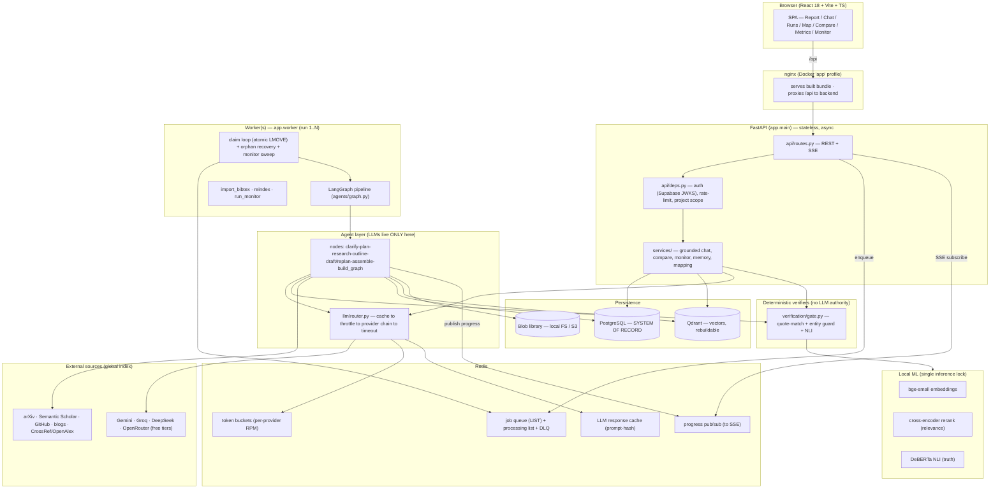

# Veriscope — Complete Project Dossier

> **Purpose of this document.** A single, self-contained reference that lets a
> coding agent (or a new engineer) understand the entire product: what it is,
> every architectural decision and *why* it was made, every feature, how the
> data flows end to end, and the implementation journey that produced it.
> It is written to be actionable without reading the rest of the repo first —
> but every claim below is cross-referenced to the file that implements it.

---

## 0. What this is, in one paragraph

**Veriscope** is a *verifiable-by-construction* research assistant. You ask a
research question; a multi-agent pipeline searches real literature (arXiv,
Semantic Scholar, GitHub, engineering blogs), ingests the sources, and drafts a
report — but **no sentence reaches the user unless it survives a deterministic
verification gate**: it must (1) cite a real corpus chunk, (2) carry a verbatim
quote that exact-matches that chunk, and (3) be entailed by that chunk under a
local NLI model. Citations render *only* from resolved reference rows, so a
fabricated citation is structurally impossible. When the corpus can't support an
answer, the system **refuses** instead of guessing. The whole thing is designed
to run on **free-tier LLMs**, because trust is enforced by the gate, not by
model quality.

**The one design law:** *agents propose, deterministic verifiers dispose.* LLMs
are never the final authority on truth.

---

## 1. The problem & the product thesis

The project began from evidence, not from a feature idea. **~55 real user
complaints** about AI research tools (SciSpace, Elicit, Consensus, NotebookLM,
ChatGPT — from Reddit, Capterra, academic forums) were analysed. The dominant
failure by far was **trust**: fabricated references, journals/years/authors that
don't exist, exact figures no paper reported. Users end up re-verifying every
citation by hand, so the time saving evaporates.

**Thesis:** *research is a trust problem, not a retrieval problem.* Everything in
the architecture follows from that single bet. (See `docs/OVERVIEW.md`,
`README.md` "The problem", `docs/INTERVIEW.md` §1.)

**Five non-negotiable guarantees** (the spec the whole system is measured
against — `docs/ARCHITECTURE.md` §1):

| # | Guarantee | Enforcement |
|---|---|---|
| G1 | Every shown claim traces to a source span (doc, page, char offsets) | `claim → chunk → quote` objects end-to-end (`db/models.py`) |
| G2 | Zero fabricated citations | References render only from resolved `Citation` rows |
| G3 | Closed corpus by default | Retrieval is project-scoped at the store level (`retrieval/hybrid.py`) |
| G4 | Refusal over fabrication | "Your corpus doesn't cover this" is a first-class answer (`services/grounded.py`) |
| G5 | Honest gaps | Unsupported sections are labelled `gap`, never papered over |

---

## 2. Architecture at a glance

```
┌──────────────────────────────────────────────────────────────┐
│  React + Vite UI  ──/api proxy──▶  FastAPI  ──SSE──▶ live UI  │
└──────────────────────────────────────────────────────────────┘
                    │ enqueue jobs (Redis LIST)
                    ▼
┌──────────────────────────────────────────────────────────────┐
│  Worker(s)  ──▶  LangGraph pipeline / monitor / import jobs   │
│   clarify→plan→research∥→ingest→outline→draft+GATE⇄replan→…   │
└──────────────────────────────────────────────────────────────┘
   │ Postgres (truth)   │ Qdrant (vectors)   │ Redis (queue/cache)
```

**Two user-facing capabilities over one shared corpus** (`docs/ARCHITECTURE.md`
§1):
1. **Deep research run** — query → multi-source research → verified report. Each
   run ingests into the *persistent* project corpus (does not evaporate).
2. **Grounded chat** — Q&A over everything the project has ever ingested, with
   click-to-source provenance and refusal when evidence is absent.

### Rule of custody (the invariant that makes the storage design sane)
- **Postgres = durable truth** (documents, chunks-metadata, claims, quotes,
  evidence, citations, runs, reports, answers, graph, memory).
- **Qdrant = vectors only**, keyed by `chunk_id` — *rebuildable* from Postgres.
- **Redis = disposable** — queue, progress pub/sub, throttle buckets, LLM cache.

Anything in Redis or Qdrant must be reconstructable from Postgres. This is what
lets a small box hold unbounded research history: text + claims are KBs/paper in
Postgres; vectors are a disposable hot cache. (`db/models.py` header,
`docs/INTERVIEW.md` §2.)

### The three processes
- **API** (`app/main.py`) — FastAPI, async, stateless behind the queue. Fail-fast
  in prod, tolerant in dev.
- **Worker** (`app/worker.py`) — claims jobs from Redis, runs the LangGraph
  pipeline / monitor / import / reindex jobs. **Run exactly one per box unless
  scaling** (job claim is atomic, so N workers are safe — but see §9).
- **Frontend** (`frontend/`) — React 18 + TS + Vite; in Docker, nginx serves the
  built bundle and proxies `/api`.

**Why API and worker are separate** (`docs/INTERVIEW.md` §2): research runs take
minutes (downloads, embeddings, multiple LLM calls). Doing that in a request
would time out and couple availability to workload. The queue decouples them,
lets the worker restart/scale independently, and makes runs crash-resumable.

---

## 3. Tech stack & why each piece

| Layer | Choice | Rationale |
|---|---|---|
| API | FastAPI (async), Pydantic v2 | async I/O for many concurrent external calls; SSE for live progress |
| Orchestration | LangGraph | explicit control flow, conditional edges (reject/replan), budgets, checkpointing — none fit a single mega-prompt |
| System of record | PostgreSQL 16 (SQLAlchemy async) — local or Supabase | relational truth + transactions + RLS; auth via Supabase |
| Vectors | Qdrant | ANN vector search, project-filtered |
| Queue / cache / progress | Redis | low-latency atomic queue, token buckets, LLM response cache, SSE fan-out |
| PDF parsing | PyMuPDF4LLM | markdown-structured parse (sections preserved), OCR fallback planned |
| Embeddings | `BAAI/bge-small-en-v1.5` (384-dim), local CPU | strong quality/size trade-off, free, no API limits |
| Rerank | `cross-encoder/ms-marco-MiniLM-L-6-v2`, local | relevance ordering **only** (not truth) |
| Entailment (NLI) | `MoritzLaurer/DeBERTa-v3-base-mnli-fever-anli`, local | truth check — entailment vs contradiction |
| LLMs | Gemini · Groq · DeepSeek · OpenRouter (free tiers) | complexity-routed fleet with fallback; see §6 |
| Observability | Prometheus · structured JSON logs · optional Sentry + Langfuse + OpenTelemetry | see §8 |
| Frontend | React 18 + TypeScript + Vite | — |

All tunables live in **one place**: `app/core/config.py` (Pydantic Settings,
`.env`-driven). Nothing else reads `os.environ` directly.

---

## 4. Data model (Postgres — `backend/app/db/models.py`)

The schema *is* the trust design; read it as such.

- **`projects`** — workspace unit; `owner_id` (RLS per user).
- **`documents`** — `source_type: paper|repo|blog|upload`; dedup keys
  (`sha256`, `doi`, `arxiv_id`, `external_id`); `supersedes_id` links
  preprint/published **without collapsing them**; honesty flags
  (`full_text_available`, `abstract_only`, `language`); lifecycle `status`:
  `pending|parsing|indexed|failed|quarantined|tombstoned`.
- **`chunks`** — `document_id`, `section`, `page_start/end`, `char_start/end`,
  `ordinal`, `text`, `embedded` bool. **Embedding lives in Qdrant under the same
  chunk id.**
- **`runs`** — a pipeline execution. `status`:
  `queued|running|completed|completed_with_gaps|failed|budget_exhausted|rejected`;
  `current_node`, `plan`, **`checkpoint` (full serialized state)**,
  `budgets_spent`, `report_id`. Checkpoint is what makes runs crash-resumable.
- **`reports`** — `outline`, `sections` (JSON), `confidence`.
- **`answers`** — grounded chat responses; **`refused` is a first-class boolean**
  with `refusal_reason` + `coverage_note`.
- **`claims`** — `text`, `status: pending|verified|failed|gap`, linked to
  `answer_id` *or* `report_id`, `section_idx`, `ordinal`.
- **`claim_evidence`** — `claim_id → chunk_id`, `quote`, `quote_match_ok`,
  `quote_char_start/end`, `nli_label`, `nli_score`. **The provenance record.**
- **`citations`** — *rows exist only after successful resolution.* `resolver:
  corpus|crossref|openalex|arxiv|github|tavily`. **This table is why fabricated
  citations can't render** — the UI reads references exclusively from here.
- **`graph_edges`** — persisted cross-source edges (`same_run`, citation,
  similarity) for the discovery Map.
- **`saved_claims`** (Notebook), **`notes`** (own synthesis), **`watches`** +
  **`monitor_alerts`** (standing monitor), **`comparisons`** (persistent
  cross-paper matrix — every cell runs the same gate), **`memories`**
  (`episodic|semantic|preference` cross-session memory, optional embedding),
  **`audit_log`**.

---

## 5. The deep-research pipeline — full data flow

**Topology** (`backend/app/agents/graph.py`, nodes in `agents/nodes.py`):

```
clarify → plan → research → outline → draft_sections → [replan?] → assemble → build_graph → END
   │(rejected)                            ↑______________________________|
   └→ END                          conditional edge back to plan (budgeted)
```

Entry point: `execute_run(run_id, scope, since_year)` in `graph.py`. It resumes
from `run.checkpoint` if present, else builds fresh state via
`new_state(...)`. The compiled graph is invoked with `recursion_limit: 40` as a
last-resort loop guard *above* the in-state budgets.

**Shared state** is a plain JSON-serializable `TypedDict` (`agents/state.py`) so
every node boundary can be checkpointed verbatim and resumed. Key fields:
`clarification`, `plan`, `scope` (`all|papers`), `since_year`, `*_doc_ids`,
`coverage_notes`, `sections[]`, `replan_targets`, `replans_used`,
`llm_calls_used`, `node_seconds`, `report_id`, `final_status`, `rejected`.

Every node is wrapped by `_timed(...)`: it checkpoints to the `runs` table,
publishes progress to Redis (→ SSE → UI), records per-node latency, and opens an
OpenTelemetry span.

### Node by node

1. **clarify** (`clarify_node`) — First runs an **intent guard** (`_intent_ok`)
   that rejects non-research/unsafe asks *before spending budget*; on reject it
   sets `run.status="rejected"` and the `clarify_route` edge routes to `END`.
   Otherwise decomposes the query into 2–5 answerable sub-questions + domain +
   objective (`Clarification` schema).

2. **plan** (`plan_node`) — Generates **source-specific search queries** (arXiv /
   Semantic Scholar / GitHub / blogs). Recalls **cross-session memory** (`services/
   memory.recall`) so the planner goes deeper instead of re-treading. On a
   **replan** pass it's told to use substantially different terms.

3. **research** (`research_node`) — **Parallel specialist agents** run
   concurrently (`asyncio.gather`), each isolated so one crashing doesn't sink
   the others (crashes become `coverage_notes`, never silent gaps):
   - **paper_agent** — searches arXiv + Semantic Scholar (time window applied at
     the *source API* to avoid paying download cost for filtered-out work),
     dedups across sources, then ingests up to `research_max_papers` (28) PDFs
     bounded by a semaphore (`ingest_pdf_concurrency`). Library-first: a PDF is
     fetched from the network at most once (`stores/blob_store.py`). No PDF but an
     abstract → ingested **labeled `abstract_only`** (honest degradation).
   - **code_agent** — GitHub repos (README as text).
   - **blog_agent** — whitelisted engineering blogs only.
   - `scope="papers"` skips the practitioner agents entirely.
   - Ends with a **retention pass** (`enforce_corpus_budget`) that moves the
     oldest *uncited* chunks to the cold tier (vectors evicted, rebuildable).

4. **outline** (`outline_node`) — Proposes a report structure where **each
   section maps to one sub-question** (no forced generic template). **Evidence-
   class separation is applied here**: if any repo/blog docs exist, a separate
   clearly-labeled `track="technical"` section ("Implementation landscape
   (practitioner sources)") is appended. Scholarly sections are `track="academic"`.
   On a replan pass the existing outline is kept; only failing sections rerun.

5. **draft_sections** (`draft_sections_node` → `_draft_one_section`) — **the
   gated loop, the heart of the system.** Per pending section:
   - **Retrieve** top-k chunks for the sub-question, restricted to the section's
     evidence class (`_TRACK_SOURCES`: academic→`[paper,upload]`,
     technical→`[repo,blog]`), with a **per-document cap** (`section_max_per_doc`)
     so a section draws on many papers instead of clustering on one.
   - **Format sources** into fenced `<SOURCE chunk_id=…>` blocks. Chunks are
     **extractively compressed** (verbatim, query-ranked, cross-chunk
     deduplicated — `retrieval/compress.py`) so more evidence fits per token
     *while staying byte-identical* (so quotes still match). Each chunk is
     **prompt-injection-screened** (`_sanitize_chunk`) — document text is data,
     never instructions.
   - **Draft** (`SectionDraft` schema): the LLM emits discrete claims, each with
     exactly one `chunk_id` + a **verbatim quote ≥12 chars** copied from that
     SOURCE block; or sets `insufficient_evidence=true`.
   - **GATE** (`verify_claims`, batched) — see §7. Only claims that pass are
     persisted as `Claim` + `ClaimEvidence` rows; failed claims **never ship**.
   - **Fail handling (enforced by topology, not convention):** support-rate <0.5
     or no verified claims → **regenerate with feedback** (≤`section_max_regens`
     = 2) → still failing → request a **sub-question replan** (≤
     `subquestion_max_replans` = 1, section set back to `pending`) → still failing
     → explicit **`gap`** with a note ("No verifiable support found…").
   - After verify, a best-effort **adaptive layout** step (`_build_layout`) may
     reorganize *already-verified* claims into a comparison table (no new text is
     authored, so cells stay gate-verified). Garbage grids are rejected by
     `build_table_layout`.

6. **replan decision** (`should_replan` conditional edge) — if `replan_targets`
   and budget remains → back to `plan`; else → `assemble`. Budgets
   (`budget_left`) cap total LLM calls (`run_max_llm_calls`=60) and wall-clock
   (`run_max_wall_seconds`=1800).

7. **assemble** (`assemble_node`) — **deterministic, no LLM.** Resolves a
   `Citation` row (`resolver="corpus"`) for every document backing a verified
   claim, writes the `Report`, bulk-links claims. `final_status` = `completed` if
   all sections verified, else `completed_with_gaps`.

8. **build_graph** (`build_graph_node`) — persists cross-source `GraphEdge`s,
   sets the run terminal status + `report_id`, and records an **episodic
   memory** of the run (best-effort but *loudly* logged on failure — a silent
   memory-write failure once hid a bug for 11 runs). Publishes a final `done`
   progress event.

### Grounded chat flow (`services/grounded.py`)
Question → **PII mask** (`core/pii.py`, question only, not source text) →
**intent guard** → **query transform** (rewrite + expansions + HyDE,
`retrieval/query_transform.py`) → **retrieve scholarly-only** (top_k=16,
max_per_doc=2) + separately retrieve **practitioner `technical_context`** (shown
alongside, never blended) → **draft** (`ChatAnswer`, can `refuse`) → **same
gate** → persist verified claims + evidence, or **refuse** (empty corpus / model
refuses / all claims fail). "Ask this paper" mode scopes retrieval to given
`document_ids`. `refind` is "where did I read this" semantic recall.

---

## 6. LLM strategy (free-tier, `llm/router.py` + `llm/clients.py`)

`router.complete()` is the **only** LLM entry point. Order of operations:
1. **Cache lookup** — prompt-hash keyed in Redis; regens & re-runs are free.
2. **Token-bucket throttle** — per-provider, honoring free-tier RPM; waits up to
   90s for a token, then fails over (never violates limits).
3. **Provider chain by task complexity** (`ROUTING`) — Groq (fast Llama-70B) for
   low-stakes classification/expansion; Gemini Flash for mid-tier structured
   JSON; DeepSeek/OpenRouter as **trailing** fallbacks (they require account
   credit — verified 402 — so they auto-activate once funded without adding a
   failed round-trip meanwhile). **Effective live fleet today: Gemini + Groq.**
   Unconfigured providers are skipped at runtime.
4. **Hard per-call timeout** (`_CALL_TIMEOUT`=150s) — a hung connection fails
   over instead of stalling a node (this is the fix behind the "stuck at clarify"
   symptom).
5. `complete_json()` — schema-validated JSON with **one structured repair
   retry** (`extract_json` defensively recovers JSON from prose/fences).

**Design stance:** accept lower *eloquence* from free models; never accept lower
*truthfulness* — truthfulness is enforced by the gate, which doesn't depend on
model quality.

---

## 7. The verification gate (`backend/app/verification/`)

Blocking, deterministic-or-local, free-tier compatible. `verify_claim` (single)
and `verify_claims` (batched NLI) share identical decision logic. Per claim, in
order:

1. **Citation resolution** (`gate.py` layer 1) — the cited chunk must exist. No
   chunk → `missing_chunk` fail.
2. **Quote exact-match** (`quote_match.py`) — the claim's quote must exist
   verbatim in the chunk after normalization (NFKC; curly quotes, dashes,
   ligatures, NBSP; PDF hyphenation `improve-\nment`→`improvement`; whitespace).
   Exact substring first; **sliding-window fuzzy fallback** (SequenceMatcher ≥
   `quote_fuzzy_threshold`=0.92) for parser noise. Quotes <12 chars are rejected
   as unfalsifiable. Offsets map back to the *original* chunk text.
   **This is the key trick: a weak model can hallucinate a paraphrase, but it
   cannot fake a quote that survives normalized exact matching.**
3. **Over-specification guard** (`gate.py` layer 2.5, `unsupported_entities`) —
   deterministic: a claim can quote-match + not-contradict yet name a *specific
   entity the source never mentions* (e.g. attributing "the EU AI Act mandates X"
   to a paper that only says "regulatory constraints"). Extracts multi-word
   proper-noun phrases + non-ubiquitous acronyms from the claim and requires each
   to appear in the chunk. Toggle: `gate_entity_check_enabled`.
4. **NLI entailment** (layer 3, local DeBERTa) — claim vs chunk. `contradiction`
   ≥ `nli_contradiction_threshold`(0.40) fails; strongly `neutral` (≥0.85) fails
   as out-of-context ("quote present but chunk says nothing about this claim").
   Batched into a single forward pass across a section's surviving claims.

**Why NLI, not a cross-encoder, for truth** (a core v1→v2 correction):
cross-encoders score *similarity* — "X improves Y" and "X does **not** improve Y"
score near-identically, so a cross-encoder rubber-stamps both. NLI distinguishes
entailment from contradiction. The cross-encoder stays, but **only for rerank**,
where similarity *is* the goal.

**Graceful degradation:** with the local ML stack off, retrieval degrades to
BM25 and NLI is skipped — but **quote-match stays the hard gate**, so the trust
guarantee survives without the ML dependencies.

---

## 8. RAG system design (end-to-end)

Veriscope's RAG is a **contextual hybrid** pipeline whose non-negotiable
constraint is that **retrieval must never break the quote-match gate**: every
transformation is either *extractive* (byte-identical to the source) or applied
only to the *query/ranking* side, never to the evidence text a quote is checked
against. The stages, in order, with the exact files:

### Indexing side (write path — `backend/app/ingestion/`)

**Stage A — Parse** (`pdf_parser.py`, PyMuPDF4LLM). PDFs → per-page **markdown**
so section structure survives. Encrypted/corrupt PDFs are **quarantined** with a
reason (never block the batch); per-page failures are recorded in
`status_reason`, not silently dropped. Size-capped by `ingest_max_pdf_mb` (50).

**Stage B — Dedup** (`dedup.py`), before any parse cost is paid twice. Cascade:
`sha256` exact → `doi` → `arxiv_id` → **fuzzy title+author** (normalized title
SequenceMatcher ≥ 0.93, corroborated by first-author surname). Preprint vs
published are **linked via `supersedes_id`, never collapsed** — different texts,
citations must point at the right one. Ingestion is **idempotent by hash**.

**Stage C — Chunk** (`chunker.py`, section-aware). Markdown → paragraph blocks
with **global char offsets** → chunks of `TARGET_CHARS`=1400 (min 200, overlap
150), split on markdown headings so each chunk carries its **section heading,
page range, and char_start/char_end**. Tiny tails merge into the previous chunk
(no unretrievable fragments). *These offsets are the provenance spine* — they are
what a citation's `quote_char_start/end` point into.

**Stage D — Contextualize + Embed** (`pipeline.py::context_text` +
`ml/local_models.py::embed_texts`). This is **deterministic Contextual
Retrieval** (the zero-LLM-cost version of Anthropic's technique): each chunk is
embedded and BM25-indexed as `"{title} — {section}\n{text}"`, so an orphan chunk
like *"it improved by 14%"* becomes findable by the paper/section it belongs to.
**Critically, only the embedding/index input is contextualized — the ORIGINAL
chunk text is stored for display and quote-matching**, so the gate is unaffected.
Embeddings: `bge-small-en-v1.5` (384-dim, cosine), batched (64), on CPU, free.

**Stage E — Index** (`stores/qdrant_store.py`). Vectors upserted to Qdrant keyed
by a UUID derived from `chunk_id`, payload = `{project_id, document_id,
chunk_id}`. **Text never goes to Qdrant** — Postgres is truth, Qdrant is
rebuildable. Embedding failure leaves the doc `indexed` with `embedded=false`
chunks that a **`reindex` job** later repairs (text is still BM25-searchable
meanwhile).

### Query side (read path — `backend/app/retrieval/`)

**Stage 1 — Query transform** (`query_transform.py`, one LLM call, **fail-open**).
Produces, together: a **rewrite** (question → paper vocabulary), 2–3
**expansions** (alternate phrasings), and a **HyDE** hypothetical-answer passage.
The HyDE passage is *never shown and never becomes evidence* — it only steers
dense retrieval; a wrong hypothesis costs recall, never correctness. On the chat
path this runs; on the pipeline drafting path the sub-question + guidance is the
query. If the call fails, retrieval proceeds on the raw query.

**Stage 2 — Hybrid retrieval + fusion** (`hybrid.py::retrieve`, closed-corpus —
**every path filters by `project_id` at the store level**, enforcing G3):
- **Lexical**: BM25 over `title + section + text` tokens. **Multi-query** — each
  transformed variant gets its own BM25 ranking, so one phrasing missing the
  corpus vocabulary no longer sinks recall.
- **Dense**: Qdrant ANN over the query embedding **and** the HyDE passage
  embedding (answer-shaped text matches answer-shaped chunks). Degrades to
  lexical-only if embedding fails.
- **Fusion**: **Reciprocal Rank Fusion** (`rrf_fuse`, k=`rrf_k`=60) over all
  dense + lexical rankings → a single candidate list (top_k×3, ≥30 fetched).
- Filters available: `source_types` (evidence-class restriction),
  `document_ids` ("Ask this paper" scope), `published_after` (year hard-floor;
  undated sources kept, never silently dropped).

**Stage 3 — Rerank + priors** (`hybrid.py`, local cross-encoder). Cross-encoder
(`ms-marco-MiniLM`) scores **relevance** (never truth) over the fused candidates,
**blended** with two small priors that only break near-ties:
`citation_weight`(0.15)·log1p(citations) + `recency_weight`(0.20)·recency
(linear decay to 0 at `recency_horizon_years`=15; undated → neutral 0.4).
**Recency is on by default** — a data-quality stance so stale work doesn't lead
even without an explicit time window. Falls back to RRF order if rerank fails.

**Stage 4 — Diversity cap** (`hybrid.py`, `max_per_doc`). Keeps ≤N chunks per
document so a corpus-wide question ("gaps across all papers") draws on many
sources instead of clustering on the single hardest-matching paper (the
"repeated-[1]" failure). This + Stage D are the two changes that fixed thin,
narrowly-sourced output.

**Stage 5 — Context compression** (`compress.py`, deterministic, **extractive
only**). Before chunks enter the LLM prompt, each is compressed by query-aware
sentence selection: split into sentences → score by lexical overlap with the
query + a mild position prior → **drop sentences near-duplicated in earlier
chunks** (a `seen` set shared across the whole SOURCE block kills cross-paper
redundancy) → keep the best within a char budget, in original order.
**NON-NEGOTIABLE: sentences are kept byte-identical, never paraphrased** — a
quote drawn from compressed context still exact-matches the full chunk in the
gate. Fully-redundant chunks return empty and are dropped (freeing token budget),
distinct from the truncation fallback for odd input.

**Stage 6 — Prompt assembly** (`nodes.py::_format_sources`). Surviving chunks
become fenced `<SOURCE chunk_id="…" doc="…" section="…" pages="…">` blocks, each
run through the **prompt-injection screen** (`_sanitize_chunk`). The model must
cite a `chunk_id` and quote verbatim from within these blocks.

**Stage 7 — Generation → verification** (`gate.py`). The model returns claims +
quotes; the **gate** (§7) resolves the chunk, exact-matches the quote against the
**original full chunk text** (`chunk_lookup` holds full text, *not* the
compressed view), checks over-specification, and NLI-entails — **batched** in one
forward pass per section. Only survivors persist as `Claim` + `ClaimEvidence`.

### Storage tiers & retention (`pipeline.py::enforce_corpus_budget`)

- **HOT** — embedded chunks in Qdrant, capped at `corpus_max_embedded_chunks`
  (4000/project). **COLD** — text + metadata + verified claims stay in Postgres
  forever (KBs/paper), vectors evicted and **rebuildable on demand** via reindex;
  cold text is still BM25-searchable.
- **Eviction order**: oldest documents first, **but chunks backing any verified
  claim are never evicted** (cited evidence is permanent). This is the concrete
  answer to "we can't store millions of papers on small infra."

### The two ML roles are strictly separated (the v1 lesson, `ml/local_models.py`)

- **cross-encoder → RELEVANCE only** (Stage 3 rerank). Never a truth signal.
- **NLI → ENTAILMENT** (the gate's truth check, §7).
  Mixing these was v1's core error: a cross-encoder rates "X improves Y" and "X
  does *not* improve Y" nearly identically. All local inference is funneled
  through a **single `threading.Lock`** (concurrent Torch calls segfault), and
  every model is lazy + feature-flagged (`ML_*_ENABLED`) so the API and tests run
  without torch. With ML off: dense retrieval and rerank degrade to BM25+RRF, NLI
  is skipped — **quote-match remains the hard gate**.

### RAG design invariants (never violate)
1. Every retrieval path filters by `project_id` (closed corpus, G3).
2. Contextualization and compression touch only *index input* / *prompt view* —
   the stored chunk text a quote is matched against stays byte-identical.
3. HyDE and query rewrites steer retrieval only; they never become evidence.
4. Cross-encoder ranks relevance; NLI judges truth — never swapped.
5. Cited chunks are never evicted from the hot tier.

---

## 9. Reliability, observability & security

**Crash-safety** (`worker.py`):
- Atomic job claim via Redis `LMOVE` (non-blocking poll loop — a prior `BLMOVE`
  raced its socket read timeout on an empty queue and killed the worker; see §11).
- **Orphan recovery on startup** — `runs` rows are truth; any non-terminal run
  has no live job after a crash, so the queue is rebuilt from them.
  **Leader-gated** (`acquire_lock`) so exactly one worker wipes+rebuilds the
  queue — otherwise a second booting worker could delete peers' jobs.
- Per-node **checkpoints** → runs resume from the last node, never restart.
- **Single inference lock** in `ml/local_models.py`: concurrent Torch
  `model.encode()` calls from multiple threads segfault the process, so all local
  inference is serialized (see §11).
- Worker loop never dies on a transient error; heartbeat every ~30s is the single
  clearest "is it alive" signal.

**Observability** (`core/observability.py`, `core/otel.py`, `llm/tracing.py`):
Prometheus `/metrics` (gate outcomes verified/failed-quote/failed-entity/
failed-nli/failed-citation, LLM calls+tokens by provider/step, node timings,
ingest counts); structured JSON logs keyed by `request_id`/`run_id`; optional
Sentry (errors), Langfuse (LLM traces), OpenTelemetry (API→queue→worker→node→
provider span tree). All optional integrations are **no-ops when unset**
(fail-open on observability).

**Security** (`docs/GOVERNANCE.md`): Supabase auth (JWKS RS256/ES256 verification,
publishable key never used for verification, legacy HS256 fallback); per-IP rate
limiting (fail-open) with a tighter budget on `/pipeline`; security headers; CORS
never `*`; `/metrics` optionally token-gated; prompt-injection screen on every
chunk; the gate as the ultimate backstop (a hijacked claim still has to
quote-match + entail a real source). Backpressure: per-project admission cap +
global queue-depth shed (503).

**Fail-open vs fail-closed law:** fail **open** on observability/auth-optional
features (never break a request); fail **closed** on trust (verification is never
silently skipped).

**Scaling:** workers scale horizontally (`--scale worker=N`, atomic claim → no
double-processing); API is stateless; stores scale independently; hot-vector tier
capped by `corpus_max_embedded_chunks` (tiered retention); blob library swappable
`local`→`s3` for multi-replica sharing.

---

## 10. Evaluation & CI

**Golden set + harness** (`backend/evals/golden.json`, `evals/run_evals.py`):
runs the *real* grounded path over a frozen mini-corpus. **Release gates that
fail CI:** fabricated citations **= 0**, claim support **≥ 98%**, refusal
correctness **≥ 95%**.

**Metrics dashboard** (in-app, `/report/{id}/metrics`): Citation Accuracy,
Answer Faithfulness (NLI), Answer Relevance (cosine), Context Precision, Context
Recall, Latency (per-node breakdown + LLM-call count). Every number traces to the
same evidence the gate produced (auditable). Deterministic metrics still compute
with the ML stack off; ML-dependent ones are reported *unavailable*, never faked.

**Unit tests** (`backend/tests/`, ~32): quote-match, gate, chunker, dedup, RRF
fusion, RAG stages, table layout, auth, memory.

**CI** (`.github/workflows/`): `ci.yml` — backend lint + unit tests + frontend
type-check/build on every push/PR. `evals.yml` — manual/scheduled groundedness
gate against real infra.

---

## 11. Implementation journey (decisions & the story behind them)

> **Note on git history:** the repository is a **single squashed commit**
> (`443a6b9 "stable version"`, 2026-06-24). The journey below is therefore
> reconstructed from `docs/ARCHITECTURE.md` (the v1→v2 redesign log),
> `docs/REDESIGN.md` (the phased roadmap), `docs/INTERVIEW.md` (STAR war
> stories), and the "learned the hard way" comments throughout the code — not
> from commit-by-commit diffs, which don't exist. Treat this as the authoritative
> narrative in the absence of granular history.

### Phase −1: the flawed v1, and why it was rebuilt
v1 was a one-shot LangGraph DAG whose fatal flaw was a `verify_node` that
computed a groundedness score and `unsupported_claims[]` **after** generating the
report — **then shipped the report anyway**. Verification *observed*; it did not
*gate*. Other v1 sins: inline `[N]` string citations renumbered across tracks;
synthesis from a compressed `rag_answer` (triple compression); a fixed report
schema; cross-encoder misused as a truth check; top-N cap *before* relevance
scoring and a 20-page parse cap; Redis-only session state with 24h TTL; no evals.
The full v1→v2 diff table is `docs/ARCHITECTURE.md` §12.

### The v2 design laws that resulted
1. Agents propose, deterministic verifiers dispose.
2. Verification **gates**, never merely observes — enforced by graph topology.
3. Loops, not a one-shot DAG — `plan` is revisitable, budgeted.
4. Citations are structured objects end-to-end; the LLM never authors `[N]`.
5. Synthesis reads raw chunks, not prior LLM prose (no triple compression).
6. Evals before features.

### v2.1 addenda (implemented over v2 — `docs/ARCHITECTURE.md` addendum)
- **Four-provider complexity-routed LLM fleet** (replaced the 2-provider pair).
- **Evidence-class separation made structural** (academic vs technical tracks
  never share a drafting context; chat attaches practitioner hits separately).
- **Tiered corpus retention** (external APIs = global index; only the working set
  is embedded (hot); text+claims persist forever (cold); chunks backing verified
  claims never evicted).
- **Supabase auth done properly** (JWKS verification).
- **arXiv PDF fallback** for Semantic Scholar hits lacking an OA PDF.

### The four hard-won reliability lessons (STAR stories, `docs/INTERVIEW.md` §3)
1. **The Torch segfault.** Runs died mid-way with *no traceback* — the worker
   process just vanished. Not OOM (15 GB free); death during embedding + no Python
   exception ⇒ a *native* crash. Root cause: up to 25 papers ingested concurrently
   each called `model.encode()` on the **same shared PyTorch model** from multiple
   threads, and Torch isn't thread-safe → segfault. **Fix: a single inference
   lock + bounded ingest concurrency.** Verified by reproducing 24 concurrent
   embed+NLI calls that used to kill the process.
2. **The idle-worker crash.** The worker died the moment the queue went idle:
   `BLMOVE` (blocking pop) raised a socket-read `TimeoutError` — the blocking
   command's server-side hold raced the client read timeout on an empty queue.
   **Fix: non-blocking `LMOVE` poll loop + resilient loop guard.** Combined with
   orphan recovery, runs stopped getting stranded.
3. **"Stuck at clarify."** A hung provider connection stalled a node forever.
   **Fix: hard per-call timeout → logged failover, never silence.**
4. **The silent memory-write failure.** A broken episodic-memory write looked
   identical to "no memory yet" in the UI, hiding a bug for 11 runs. **Fix: log
   it loudly** (the code comment at `build_graph_node` records this).

Meta-lesson: *silent failures are the worst* → build visibility first
(heartbeats, per-call timing, hard timeouts) so the last log line tells you where
it broke.

### Quality tuning decisions worth knowing
- **Thin/narrow reports** were caused by sections clustering on the 1–2
  hardest-matching papers (the "repeated-[1]" problem). Fixed with per-document
  retrieval diversity (`section_max_per_doc`) + a wider evidence window + a
  drafting prompt that pushes 6–10 claims across many documents. **Report depth
  comes from `section_max_per_doc` + the prompt, not raw corpus size** — raising
  `research_max_papers` 25→40 added ~15 min for little gain, so it's pinned at 28.
- **Corpus-wide chat** clustering on one tangential paper → per-doc diversity +
  contextual embeddings (title+section) — the zero-LLM-cost version of
  Anthropic's Contextual Retrieval.

### Product decisions (what was deliberately NOT built — `docs/INTERVIEW.md` §6,
`docs/GOVERNANCE.md`)
- **No graph database (Neo4j).** The Map is small (tens of papers), edges are
  computed in app code + cached; a graph DB would be operational overhead with no
  payoff. Neo4j earns its place only if the Map becomes a corpus-wide citation
  graph queried by traversal.
- **Deferred:** real-time collaboration, hosted multi-tenant deployment, a vanity
  knowledge graph, second-model adjudication band, bias/fairness audit on
  retrieval, formal data-retention policy — all listed in `GOVERNANCE.md` as
  *decisions*, not oversights, to keep the trust core sharp.
- **The Map stays papers-only** (pushed back on a request to add repos/blogs):
  mixing practitioner sources would violate evidence-class separation and dilute
  the citation/similarity signal.

### Roadmap (`docs/REDESIGN.md` — "Veriscope 2.0")
Positioning shift: from "Elicit but verified" to a *research-automation
workspace* (find→screen→extract→verify→reproduce) targeting applied-ML/SWE
researchers, with repos as first-class reproducibility artifacts. Phase 1
(stabilize/OSS, recency ranking, real clarification pause), Phase 2 (interactive
"Quick — Find & Screen" mode, verified extraction columns, reproducibility check,
quality-critic retrieve⇄screen⇄critic loop, domain-adaptive prompts), Phase 3
(scale: full-text ingestion, model-server split, horizontal deploy, Zotero
import).

---

## 12. Features (complete list)

**Research & verification** — deep-research pipeline (with budgets, checkpoints,
intent guardrail); the verification gate; evidence-class separation; contextual
hybrid RAG.

**Reading/working with results** — readable reports with confidence-coloured
inline citations (click → highlighted quote), contradiction detection,
multi-format export (Markdown/BibTeX/RIS/Print-PDF); interactive discovery **Map**
(citation + similarity edges); **"Ask this paper/repo/source"** page-anchored Q&A;
**grounded chat**; **Notebook** (saved verbatim quotes); **Notes** (own
synthesis); **Resume panel** (open gaps → one-click re-search); persistent
**Comparison** matrix (every cell gate-verified).

**Proactive & ops** — **standing monitor agent** (re-checks arXiv/Semantic
Scholar for new papers matching your questions, scores + surfaces them); **live
SSE progress**; device-local PDF library; BibTeX import; tiered retention;
**cross-session memory** (episodic/semantic/preference, recalled at planning);
Supabase auth; security headers + rate limiting; CI-gated groundedness eval
harness; **metrics dashboard**.

---

## 13. API surface (`backend/app/api/routes.py`, base `/api`)

`/health`, `/metrics` (unprefixed). Projects & documents CRUD; `import/bibtex`;
`POST /pipeline` (start run) + `GET /status/{id}` + `GET /status/{id}/stream`
(SSE); `GET /report/{id}` + `/contradictions` + `/metrics` + `/next-questions`;
`POST /chat`; `POST /refind`; `GET /claims/{id}/evidence`; `POST /clarify`;
discovery `GET /projects/{id}/map` + `GET /graph/{id}`; monitor
(`/monitor`, `/watches`, `/monitor/check`, `/alerts/{id}/dismiss|add`);
notebook, notes, memory (+ `/recall`), resume (`/runs/{id}/resume`), compare
(`/compare`, `/comparisons/...`), `/recommend`.

Frontend views (`frontend/src/App.tsx`): home, chat, runs, report, documents,
notebook, notes, monitor, memory, map, compare, metrics, about.

---

## 14. Running it

```bash
# Docker (whole app: UI + API + worker + Postgres/Redis/Qdrant) → http://localhost:8080
cp .env.example backend/.env            # add at least one free LLM key (Gemini/Groq)
docker compose --profile app up --build
```

```bash
# From source
docker compose up -d                    # Postgres :5433, Redis :6380, Qdrant :6333
cp .env.example backend/.env            # set AUTH_DISABLED=true for local
cd backend && python -m venv .venv && .venv/Scripts/activate
pip install -e . && pip install -e ".[ml]"   # [ml] ≈ 2 GB local models
uvicorn app.main:app --port 8210        # terminal 1
python -m app.worker                    # terminal 2 — run exactly ONE
cd ../frontend && npm install && npm run dev   # terminal 3 → http://localhost:5173
```

Auth is off by default (`AUTH_DISABLED=true`, open demo). Without `[ml]`,
retrieval degrades to BM25 and NLI is skipped — quote-match stays the hard gate.
Key env knobs live in `backend/app/core/config.py`.

---

## 15. Fastest path to orientation (for the next agent)

1. **Trust model** → `verification/gate.py` + `verification/quote_match.py` +
   `db/models.py` (`Citation`, `ClaimEvidence`). This *is* the product.
2. **Control flow** → `agents/graph.py` then `agents/nodes.py`
   (`_draft_one_section` is the crux).
3. **Data flow** → `retrieval/hybrid.py` (in) → gate (filter) → `assemble_node`
   (out).
4. **Ops reality** → `worker.py` (crash-safety) + `llm/router.py` (free-tier
   survival) + `core/config.py` (every tunable and the reasoning in its comments).
5. **Why anything is the way it is** → this file §11, `docs/ARCHITECTURE.md` §12,
   `docs/INTERVIEW.md` §3.

**Invariants to never break:** references render only from `Citation` rows (G2);
no claim ships without passing `verify_claims` (G1); retrieval always filters by
`project_id` (G3); refusal is a valid outcome, not a failure (G4); Postgres is
truth, Qdrant/Redis are rebuildable; all local inference goes through the single
lock.

---

## 16. Architecture (detailed)

This section is the "give-me-the-blueprint" view: component boundaries,
deployment topology, and the exact runtime sequence of a request. The narrative
version is §2; this is the reference version.

### 16.1 Component / container diagram



**Boundaries that matter:**
- **LLMs are confined to the agent layer** (`nodes.py` via `router.py`). No
  route, service, or verifier calls an LLM to decide truth.
- **Verifiers are deterministic** and sit *between* the agent layer and
  persistence — a claim reaches Postgres only after `gate.py` passes it.
- **Stores have fixed roles** (custody rule §2): Postgres truth; Qdrant + Redis +
  Blob rebuildable/disposable.

### 16.2 Deployment topology (Docker `--profile app`)

```
                         WEB_PORT (8080)
                              |
                        +-----v-----+
                        |   nginx    |  frontend container: built bundle + /api proxy
                        +-----+-----+
                              | /api
                        +-----v-----+        +--------------+
                        |  FastAPI   |<------>|   Postgres    |  :5432 (system of record)
                        |  (api)     |        +--------------+
                        +-----+-----+        +--------------+
                              |              |    Qdrant     |  :6333 (vectors)
                    enqueue / | SSE          +--------------+
                     progress |              +--------------+
                        +-----v-----+        |    Redis      |  :6379 (queue/cache/pubsub)
                        |  Redis     |<------>+--------------+
                        +-----+-----+
                              | claim jobs (atomic LMOVE)
              +---------------+---------------+
        +-----v-----+   +-----v-----+   +-----v-----+
        | worker #1  |   | worker #2  |   | worker #N |  (--scale worker=N; safe, atomic claim)
        +-----------+   +-----------+   +-----------+
              | shared blob library (local FS single-node, or S3/MinIO/R2 multi-node)
```

- **Scale-out unit is the worker.** API is stateless; add workers for throughput.
  Blob backend must move `local` to `s3` before running >1 worker box (so replicas
  share the PDF library). Postgres pool sizing = workers × in-flight sessions.
- **Backpressure**: per-project admission cap (`max_concurrent_runs_per_project`)
  + global `max_queue_depth` to 503 shed.
- **Optional observability sidecars** (`docker-compose.observability.yml`):
  Prometheus, Grafana (dashboard `deploy/observability/grafana/...veriscope.json`),
  Loki + Promtail (logs), Tempo (OTel traces).

### 16.3 Runtime sequence — a deep-research run

```mermaid
sequenceDiagram
    participant U as User (SPA)
    participant A as FastAPI
    participant R as Redis
    participant W as Worker (LangGraph)
    participant X as External APIs
    participant G as Gate + local ML
    participant P as Postgres

    U->>A: POST /api/clarify (intent guard + questions)
    A-->>U: allowed? clarifying questions
    U->>A: POST /api/pipeline (query, scope, since_year)
    A->>P: INSERT run (status=queued)
    A->>R: enqueue run_pipeline
    A-->>U: 202 run_id
    U->>A: GET /api/status/{id}/stream (SSE)
    W->>R: claim_job (atomic LMOVE)
    loop each node
        W->>P: checkpoint state (runs.checkpoint)
        W->>R: publish progress (SSE to U live timeline)
    end
    W->>X: search + download PDFs (parallel agents)
    W->>P: ingest documents + chunks
    W->>G: draft claims then verify (quote-match + entity + NLI, batched)
    G-->>W: verified or failed (regen <=2, replan <=1, gap)
    W->>P: persist ONLY verified claims + evidence
    W->>P: assemble report + resolve Citation rows
    W->>R: publish done (SSE to U)
    U->>A: GET /api/report/{id}
    A->>P: read report + claims + evidence
    A-->>U: report (claims as objects; refs from Citation rows only)
```

**Two independent request lifecycles:**
- **Short/synchronous** (`/chat`, `/report`, `/refind`, CRUD): handled in-request
  by the API + services, still passes the same gate for chat.
- **Long/asynchronous** (`/pipeline`, `import`, `monitor`, `reindex`): enqueued,
  run by the worker, observed live via SSE, resumable via checkpoints.

### 16.4 Trust-enforcement chain (the architecture's reason to exist)

```
LLM draft -> [1 citation resolves?] -> [2 quote exact-match?] -> [3 entity guard?] -> [4 NLI entails?]
   |             | no                   | no                     | no                  | no
   |             v                      v                        v                     v
   |          FAIL ------------- regenerate (<=2) -- replan sub-question (<=1) -- explicit GAP
   v
 pass -> Claim + ClaimEvidence (Postgres) -> Citation row -> UI renders reference
```
No path exists from an unverified claim to a rendered citation — that absence
*is* guarantee G2.

---

## 17. Frontend — how the system is shown to the user

The UI's job is singular: **make verification visible and trust legible.** Every
surface is built so a user can go from a sentence to its exact source in one
click, and so honesty (gaps, refusals, coverage notes) is shown, never hidden.
Stack: React 18 + TypeScript + Vite, no component framework — hand-rolled
components + a design-token CSS (`styles.css`), `api.ts` typed client, `auth.ts`
optional Supabase.

### 17.1 Shell, navigation & mental model (`App.tsx`)

- **One linear mental model** exposed as numbered step-tabs:
  **1 Research → 2 Report → 3 Ask follow-ups.** Everything else (Sources,
  Compare, Map, Metrics, Monitor, Memory, Notes, Notebook, About) lives behind a
  single calm **"Tools"** dropdown — deliberately Elicit-like restraint.
- **Landing → (optional) Login → Workspace.** Landing shows once per browser
  session; a deep link (`#/p/<id>/<view>`) skips straight in. Auth is optional
  (`authEnabled`); when off, the demo is fully open.
- **Project = workspace.** Left rail lists projects; the home composer turns a
  question into a new project and hands off to the Research view.
- **URL routing** reflects `project + view` in the hash so links are
  shareable/bookmarkable and survive refresh (careful initial-hash capture so a
  refresh isn't clobbered before restore).
- **Keep-alive tabs:** once visited, a view stays *mounted* (hidden via CSS), so a
  running report's live polling, chat history, unsent input, and scroll never
  reset on tab switch.
- **Honest connection state:** `apiState` distinguishes `ok | down (unreachable) |
  auth (session expired)` — conflating them once sent users chasing a dead
  backend when they just needed to sign in.
- **Resume banner** on every project (`ResumeBanner`) surfaces unfinished
  runs/open gaps — the "welcome back" continuity surface.

### 17.2 The verified report (`ReportView.tsx`) — the trust centrepiece

This is where verification is made tangible:
- **Header trust pills:** `X/Y sections grounded` (green only if all verified),
  `N sources`, a **year-span pill** (`sources 2019-2025 · 8/12 since 2022`) that
  makes the recency claim *verifiable, not a promise*, `~N min read`, and the
  standing note *"Every sentence is quote-verified · click any superscript to see
  the source."*
- **Confidence-coloured inline citations:** each claim's superscript is coloured
  **strong vs moderate** from the NLI gate (`nli_label === "entailment" &&
  nli_score >= 0.8` -> strong). The colour *is* the evidence-strength signal.
- **Click-to-source:** clicking any citation opens the **Evidence Drawer** (§17.3).
- **Evidence-class separation is visible:** if practitioner sources exist, the
  report splits into **Scholarly report** vs **Practitioner sources** tabs, the
  latter carrying an explicit banner *"not peer-reviewed … implementation signal,
  not evidence."* References lists are filtered per class — practitioner refs
  never appear in the scholarly reference list.
- **Key findings** (one lead claim per section), **"Tensions in the evidence"**
  (contradiction pairs shown side-by-side, both individually quote-verified),
  and an honest **"Evidence gap"** block per unsupported section.
- **Adaptive comparison tables** (`ClaimTable`): when the backend chose a table
  layout, each cell is a *verified* claim (by index) — still coloured and
  click-to-source. Footnote: *"Every cell is a quote-verified claim."*
- **References note** states the guarantee in-product: *"Every reference resolved
  against the corpus, so fabricated citations are structurally impossible."*
- **Export** to Markdown / BibTeX / RIS / Print-PDF, references numbered in
  citation order so superscripts match.

### 17.3 The Evidence Drawer (`EvidenceDrawer.tsx`) — proof, on click

The single most important UI for the product thesis. For a clicked claim it shows:
- the **source document** (type, title, `section · pages X-Y`, plus honest
  labels `ABSTRACT ONLY` / `SOURCE REMOVED` for tombstoned docs);
- **verification stamps**: `quote verified` + `nli: entailment 0.98` (or the
  neutral/contradiction label);
- the **full source passage with the exact quote highlighted** at the stored
  `quote_char_start/end` offsets — the user literally sees the matched span in
  context;
- a link to open the original source; and actions to **Save to notebook**
  (verbatim finding) or **Note this** (own synthesis, seeded from the quote).

### 17.4 Live research progress (`RunsView.tsx`)

- **Clarification pause is real UI:** every launch (even from the home composer)
  first calls `/clarify`; an off-topic ask renders *"Not a research question"*,
  otherwise 1-3 clarifying questions block until answered or skipped.
- **Streaming timeline:** a 7-node progress rail (researcher-facing labels:
  `clarify · plan searches · search & read · structure · draft + verify ·
  finalize · link sources`) driven by **SSE** (`/status/{id}/stream`), with a
  de-duplicated **live activity feed**, seconds elapsed, `sections done/total`,
  and the latest **coverage note** surfaced inline (partial failures shown, not
  hidden). Polling backs off (2.5s active to 12s idle); terminal runs fetched once.
- **Resume/continuity:** latest report summary, **open-gap chips** (one-click
  re-search of a gap), and **suggested next questions**.

### 17.5 Grounded chat (`ChatView.tsx`)

- Answers render as **verified-claim lists** with a `N verified claims` stamp;
  each claim links to its Evidence Drawer; source title/page/`abstract only`
  shown inline.
- **Refusal is a first-class, designed state:** *"Refused — honestly"* with the
  reason + coverage note — visually distinct from an error.
- **"Ask this paper/repo/source"** mode: page-anchored citations (`p.12` / section
  glyph), source-type-aware starter chips and copy.
- **Practitioner signal** is rendered in a separate *"Practitioner signal —
  separate evidence class, not part of the answer"* panel — the evidence-class
  wall the backend enforces is mirrored in the UI.

### 17.6 The rest of the surfaces (Tools)

- **Map** (`MapView`, lazy-loaded — force-directed SVG) — papers linked by
  citation + similarity; multi-select feeds **Compare**.
- **Compare** (`CompareView`) — pick 2-5 papers; each cell drafted from that paper
  alone and **gate-verified** (click-to-source), empty cells are honest "doesn't
  address this."
- **Metrics** (`MetricsView`) — the six-metric RAG eval dashboard, every number
  traced to the evidence that produced it.
- **Monitor** (`MonitorView`) — standing watches + surfaced new-paper alerts
  (dismiss / one-click add).
- **Memory** (`MemoryView`) — what the project remembers across runs.
- **Notebook** (verbatim saved findings) / **Notes** (own synthesis) — the
  persistent library.
- **About** (`AboutView`) — mirrors `docs/OVERVIEW.md`: transparent by design.

### 17.7 The UI-side design law

The frontend enforces the same law as the backend, in presentation form:
**nothing is shown as fact without a one-click path to its proof, and every
honest negative (gap, refusal, coverage note, "abstract only", "not
peer-reviewed", "source removed") is surfaced, never smoothed over.** The colour
of a citation, the split of a report into evidence classes, and the existence of
the Evidence Drawer are all the *trust thesis made visible*.
